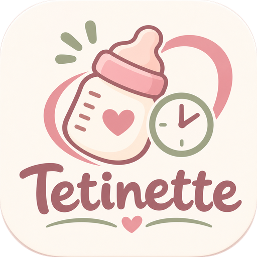
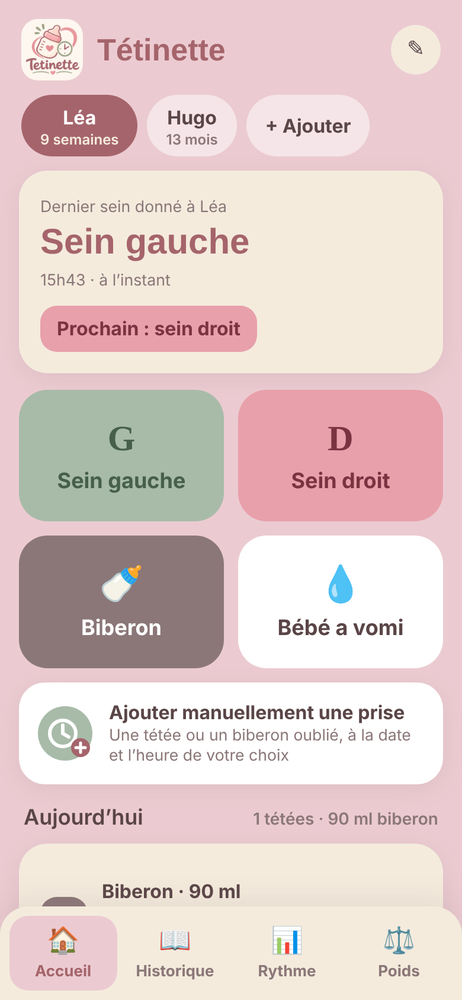
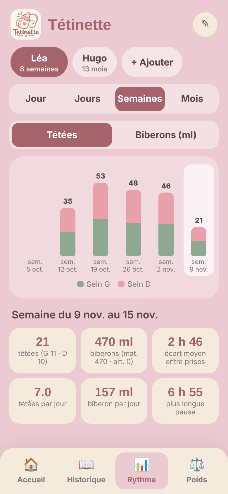

<p align="center">
  
</p>

<h1 align="center">Tétinette</h1>

<p align="center">
  <em>Le carnet de bord douillet des premiers mois : tétées, biberons, vomis et courbe de poids, sur votre propre serveur.</em>
</p>

<p align="center">
  
  
  
</p>

---

## Pourquoi Tétinette ?

Noter les tétées sur un bloc-notes à 3 h du matin, retrouver *quel sein* on a donné en dernier, additionner les millilitres de biberon, se souvenir du rythme de la journée… Tétinette remplace le papier par une petite application web **simple, rapide et agréable**, pensée pour être utilisée d'une main sur un téléphone.

Elle tourne chez vous, dans un conteneur Docker. Vos données restent sur votre serveur : pas de compte, pas de cloud, pas de publicité.

<table>
  <tr>
    <td align="center"></td>
    <td align="center"></td>
  </tr>
  <tr>
    <td align="center"><sub>L'accueil : dernier sein donné et prochain conseillé, saisie en un appui</sub></td>
    <td align="center"><sub>Le rythme : tétées par semaine, détail au toucher</sub></td>
  </tr>
</table>

## Fonctionnalités

- **Saisie rapide.** Un appui sur « Sein gauche » ou « Sein droit » ouvre la fenêtre de saisie avec le bon type déjà sélectionné et l'heure actuelle : il ne reste qu'à valider, ou à ajuster l'heure et ajouter un commentaire.
- **Le bon sein à portée de vue.** L'accueil affiche le dernier sein donné, l'heure, le temps écoulé, et suggère le sein opposé pour la prochaine fois.
- **Biberons.** Lait maternel ou artificiel, quantité en ml, date et heure modifiables.
- **Commentaire sur chaque prise.** Une note libre sur une tétée, un biberon ou un vomi (« tétée agitée », « s'est endormie »…). Elle s'ajoute lors de la saisie. Toucher une ligne de l'historique permet de modifier ou supprimer la prise.
- **Suivi des vomis.** Un bouton « Bébé a vomi » avec 4 niveaux de quantité (régurgitation, petite, moyenne, grande). Les vomis apparaissent dans l'historique et le résumé du rythme, sans fausser le nombre de tétées ni les écarts entre prises.
- **Saisie manuelle.** Pour ajouter une tétée ou un biberon oublié, à la date et à l'heure de votre choix.
- **Plusieurs bébés.** Jumeaux, fratrie : chaque bébé a son profil (prénom, date de naissance), son historique, son rythme et ses pesées.
- **Rythme de la journée et au-delà.** Vue *Jour* heure par heure, puis vues *Jours*, *Semaines* et *Mois* en diagrammes en bâtons que l'on fait défiler. Un appui sur une barre affiche le détail : nombre de tétées, répartition gauche/droite, millilitres, écart moyen entre deux prises, plus longue pause.
- **Courbe de poids.** Affichage par date, ou par âge en mois grâce à la date de naissance, avec le gain depuis la pesée précédente.
- **Installable.** Ajoutez-la à l'écran d'accueil du téléphone : elle se comporte comme une vraie application.

## Démarrage rapide

Il vous faut simplement [Docker](https://docs.docker.com/get-docker/) avec le plugin Compose.

```bash
git clone https://github.com/florent6901/tetinette.git
cd tetinette
docker compose up -d --build
```

Ouvrez ensuite **http://IP-DU-SERVEUR:8086** sur votre téléphone ou votre ordinateur. Au premier lancement, l'application vous demande le prénom et la date de naissance de votre bébé.

### Sans Compose

```bash
docker build -t tetinette .
docker run -d --name tetinette --restart unless-stopped \
  -p 8086:8086 -v "$(pwd)/data:/data" -e HTTPS=false tetinette
```

## Configuration

| Réglage | Où | Valeur par défaut |
|---|---|---|
| Port d'accès | `docker-compose.yml` → `ports` (ex. `"8080:8086"`) | `8086` |
| HTTPS | `docker-compose.yml` → `HTTPS` | `false` |
| Noms/IP du certificat auto-signé | `docker-compose.yml` → `TLS_HOSTNAMES` | `localhost` |
| Certificat personnel | `TLS_CERT` et `TLS_KEY` | certificat auto-signé dans `data/certs/` |
| Fuseau horaire | `Dockerfile` → `ENV TZ=` | `Europe/Paris` |
| Emplacement de la base | variable d'environnement `DB_PATH` | `/data/bebe.db` |

## Activer le HTTPS

Dans `docker-compose.yml`, passez le paramètre `HTTPS` à `true` :

```yaml
environment:
  - HTTPS=true
  - TLS_HOSTNAMES=localhost,192.168.1.50   # nom(s) et IP par lesquels vous accédez à l'app
```

Relancez avec `docker compose up -d --build`, puis ouvrez **https://IP-DU-SERVEUR:8086**. Le même port sert alors en HTTPS (le HTTP simple n'y répond plus).

- **Par défaut**, un certificat auto-signé est généré au premier démarrage et conservé dans `data/certs/`. Les échanges sont chiffrés, mais le navigateur affiche un avertissement la première fois : acceptez l'exception. Si vous changez `TLS_HOSTNAMES`, supprimez le dossier `data/certs/` pour régénérer le certificat.
- **Avec votre propre certificat** (Let's Encrypt, autorité interne…), montez-le dans le conteneur et renseignez `TLS_CERT` et `TLS_KEY`, comme indiqué en commentaire dans `docker-compose.yml`.
- **Derrière un reverse proxy** (Nginx Proxy Manager, Traefik, Caddy), laissez `HTTPS=false` et laissez le proxy gérer le certificat.

## Vos données

Tout est stocké dans une base SQLite unique, dans le dossier `data/` créé à côté du `docker-compose.yml`. Il survit aux mises à jour et aux redémarrages.

- **Sauvegarde :** copiez simplement `data/bebe.db`.
- **Mise à jour :** `git pull && docker compose up -d --build`. La base est migrée automatiquement.

## Sécurité

Tétinette n'a **pas d'authentification** : elle est conçue pour un réseau local. Le HTTPS chiffre les échanges mais ne remplace pas un mot de passe. Si vous l'exposez sur Internet, placez-la derrière un reverse proxy avec authentification (Nginx Proxy Manager, Traefik, Caddy…) ou derrière un VPN.

## Structure du projet

```
tetinette/
├── app/
│   ├── server.py            # Serveur HTTP + API JSON + base SQLite (bibliothèque standard Python)
│   └── static/
│       ├── index.html       # Toute l'interface (HTML, CSS et JS)
│       ├── manifest.json    # Installation sur l'écran d'accueil
│       ├── logo.png
│       └── *.png            # Icônes (favicon, apple-touch-icon, 192 et 512 px)
├── docs/
│   └── screenshots/         # Captures d'écran du README
├── Dockerfile
├── docker-compose.yml
├── .dockerignore
├── .gitignore               # Exclut data/ (vos données personnelles)
├── LICENSE
└── README.md
```

## Sous le capot

- **Backend :** Python 3, uniquement la bibliothèque standard (`http.server`, `sqlite3`, `ssl`). Aucune dépendance Python ; `openssl` n'est utilisé que pour générer le certificat auto-signé.
- **Frontend :** une page unique en HTML, CSS et JavaScript sans framework ni étape de build. Polices Grandstander et Nunito chargées depuis Google Fonts, avec des polices de secours si le téléphone est hors ligne.
- **Graphiques :** diagrammes en HTML/CSS et courbe de poids en SVG, sans bibliothèque.

### API

| Méthode | Route | Rôle |
|---|---|---|
| `GET` | `/api/data` | Bébés, prises et pesées |
| `POST` | `/api/events` | Ajouter une tétée, un biberon ou un vomi |
| `PUT` | `/api/events/<id>` | Modifier une prise (heure, quantité, commentaire…) |
| `DELETE` | `/api/events/<id>` | Supprimer une prise |
| `POST` | `/api/weights` | Ajouter une pesée |
| `DELETE` | `/api/weights/<id>` | Supprimer une pesée |
| `POST` | `/api/babies` | Ajouter un bébé |
| `PUT` | `/api/babies/<id>` | Modifier un bébé |
| `DELETE` | `/api/babies/<id>` | Supprimer un bébé et toutes ses données |

## Idées pour la suite

- Courbes de croissance de référence (OMS) pour situer le poids
- Chronomètre de tétée
- Suivi des couches, du sommeil, de la taille
- Export CSV
- Protection par mot de passe
- Rechargement automatique du certificat

Les suggestions et les contributions sont les bienvenues.

## Licence

[MIT](LICENSE). Fait avec amour pour les petits et leurs parents fatigués.
