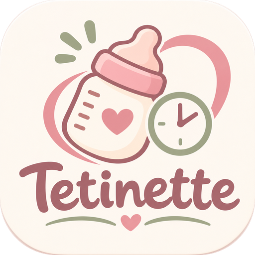
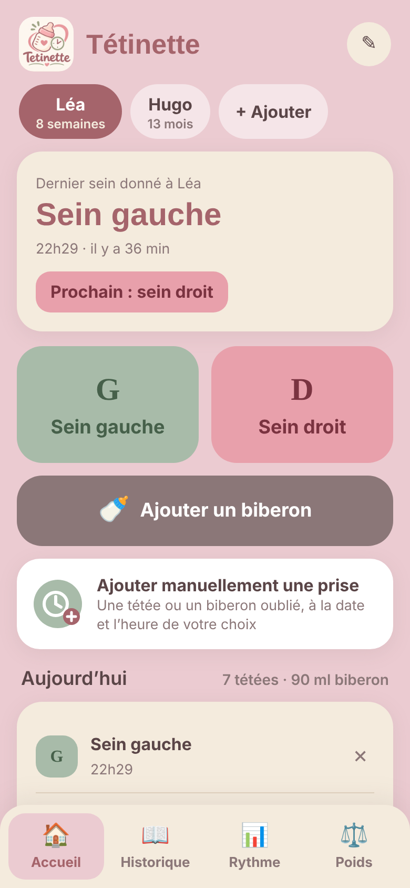
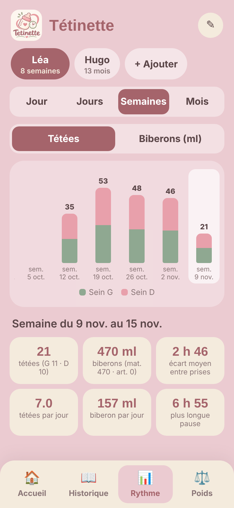

<p align="center">
  
</p>

<h1 align="center">Tétinette</h1>

<p align="center">
  <em>Le carnet de bord douillet des premiers mois : tétées, biberons et courbe de poids, sur votre propre serveur.</em>
</p>

<p align="center">
  
  
  
</p>

---

## Pourquoi Tétinette ?

Noter les tétées sur un bloc-notes à 3 h du matin, retrouver *quel sein* on a donné en dernier, additionner les millilitres de biberon, se souvenir du rythme de la journée… Tétinette remplace le papier par une petite application web **simple, rapide et agréable**, pensée pour être utilisée d'une main sur un téléphone.

Elle tourne chez vous, dans un conteneur Docker. Vos données restent sur votre serveur : pas de compte, pas de cloud, pas de publicité.

<table>
  <tr>
    <td align="center"></td>
    <td align="center"></td>
  </tr>
  <tr>
    <td align="center"><sub>L'accueil : dernier sein donné et prochain conseillé, enregistrement en un appui</sub></td>
    <td align="center"><sub>Le rythme : tétées par semaine, détail au toucher</sub></td>
  </tr>
</table>

## Fonctionnalités

- **Tétées en un appui.** Un bouton « Sein gauche » et un bouton « Sein droit » enregistrent la prise à l'instant, avec un bouton *Annuler* pendant quelques secondes.
- **Le bon sein à portée de vue.** L'accueil affiche le dernier sein donné, l'heure, le temps écoulé, et suggère le sein opposé pour la prochaine fois.
- **Biberons.** Lait maternel ou artificiel, quantité en ml, date et heure modifiables.
- **Saisie manuelle.** Pour ajouter une tétée ou un biberon oublié, à la date et à l'heure de votre choix.
- **Plusieurs bébés.** Jumeaux, fratrie : chaque bébé a son profil (prénom, date de naissance), son historique, son rythme et ses pesées.
- **Rythme de la journée et au-delà.** Vue *Jour* heure par heure, puis vues *Jours*, *Semaines* et *Mois* en diagrammes en bâtons que l'on fait défiler. Un appui sur une barre affiche le détail : nombre de tétées, répartition gauche/droite, millilitres, écart moyen entre deux prises, plus longue pause.
- **Courbe de poids.** Affichage par date, ou par âge en mois grâce à la date de naissance, avec le gain depuis la pesée précédente.
- **Installable.** Ajoutez-la à l'écran d'accueil du téléphone : elle se comporte comme une vraie application.

## Démarrage rapide

Il vous faut simplement [Docker](https://docs.docker.com/get-docker/) avec le plugin Compose.

```bash
git clone https://github.com/florent6901/tetinette.git
cd tetinette
docker compose up -d --build
```

Ouvrez ensuite **http://IP-DU-SERVEUR:8086** sur votre téléphone ou votre ordinateur. Au premier lancement, l'application vous demande le prénom et la date de naissance de votre bébé.

### Sans Compose

```bash
docker build -t tetinette .
docker run -d --name tetinette --restart unless-stopped \
  -p 8086:8086 -v "$(pwd)/data:/data" tetinette
```

## Configuration

| Réglage | Où | Valeur par défaut |
|---|---|---|
| Port d'accès | `docker-compose.yml` → `ports` (ex. `"8080:8086"`) | `8086` |
| Fuseau horaire | `Dockerfile` → `ENV TZ=` | `Europe/Paris` |
| Emplacement de la base | variable d'environnement `DB_PATH` | `/data/bebe.db` |

## Vos données

Tout est stocké dans une base SQLite unique, dans le dossier `data/` créé à côté du `docker-compose.yml`. Il survit aux mises à jour et aux redémarrages.

- **Sauvegarde :** copiez simplement `data/bebe.db`.
- **Mise à jour :** `git pull && docker compose up -d --build`. La base est migrée automatiquement.

## Sécurité

Tétinette n'a **pas d'authentification** : elle est conçue pour un réseau local. Si vous l'exposez sur Internet, placez-la derrière un reverse proxy avec authentification (Nginx Proxy Manager, Traefik, Caddy…) ou derrière un VPN.

## Structure du projet

```
tetinette/
├── app/
│   ├── server.py            # Serveur HTTP + API JSON + base SQLite (bibliothèque standard Python)
│   └── static/
│       ├── index.html       # Toute l'interface (HTML, CSS et JS)
│       ├── manifest.json    # Installation sur l'écran d'accueil
│       ├── logo.png
│       └── *.png            # Icônes (favicon, apple-touch-icon, 192 et 512 px)
├── docs/
│   └── screenshots/         # Captures d'écran du README
├── Dockerfile
├── docker-compose.yml
├── .dockerignore
├── .gitignore               # Exclut data/ (vos données personnelles)
├── LICENSE
└── README.md
```

## Sous le capot

- **Backend :** Python 3, uniquement la bibliothèque standard (`http.server`, `sqlite3`). Rien à installer, une image Docker de quelques dizaines de Mo.
- **Frontend :** une page unique en HTML, CSS et JavaScript sans framework ni étape de build. Polices Grandstander et Nunito chargées depuis Google Fonts, avec des polices de secours si le téléphone est hors ligne.
- **Graphiques :** diagrammes en HTML/CSS et courbe de poids en SVG, sans bibliothèque.

### API

| Méthode | Route | Rôle |
|---|---|---|
| `GET` | `/api/data` | Bébés, prises et pesées |
| `POST` | `/api/events` | Ajouter une tétée ou un biberon |
| `DELETE` | `/api/events/<id>` | Supprimer une prise |
| `POST` | `/api/weights` | Ajouter une pesée |
| `DELETE` | `/api/weights/<id>` | Supprimer une pesée |
| `POST` | `/api/babies` | Ajouter un bébé |
| `PUT` | `/api/babies/<id>` | Modifier un bébé |
| `DELETE` | `/api/babies/<id>` | Supprimer un bébé et toutes ses données |

## Idées pour la suite

- Courbes de croissance de référence (OMS) pour situer le poids
- Chronomètre de tétée
- Suivi des couches, du sommeil, de la taille
- Export CSV
- Protection par mot de passe

Les suggestions et les contributions sont les bienvenues.

## Licence

[MIT](LICENSE). Fait avec amour pour les petits et leurs parents fatigués.
